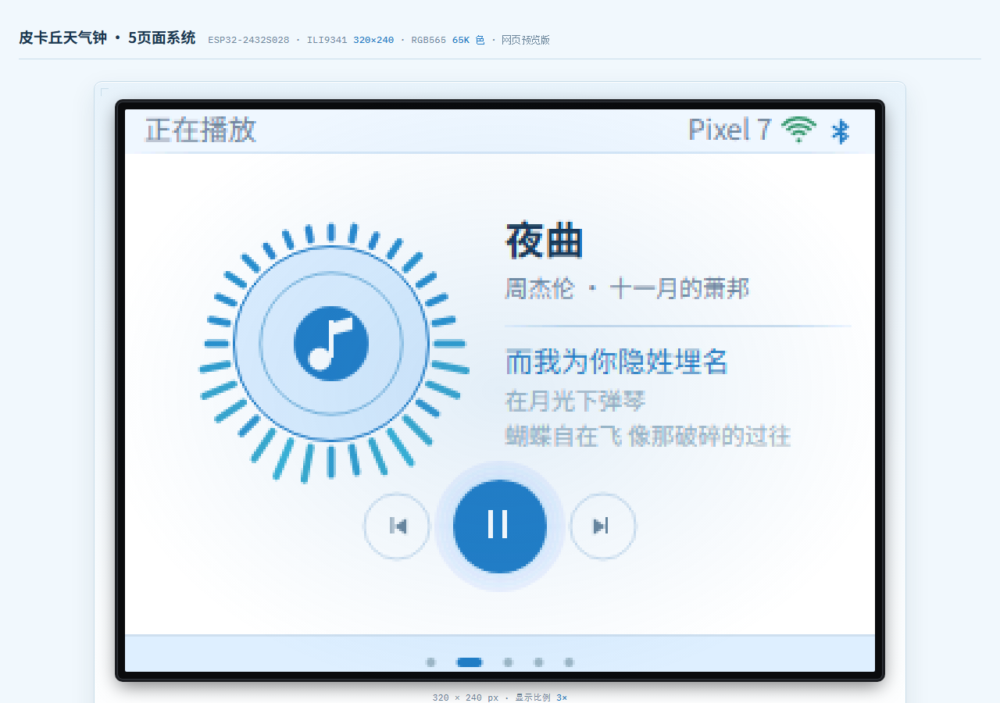
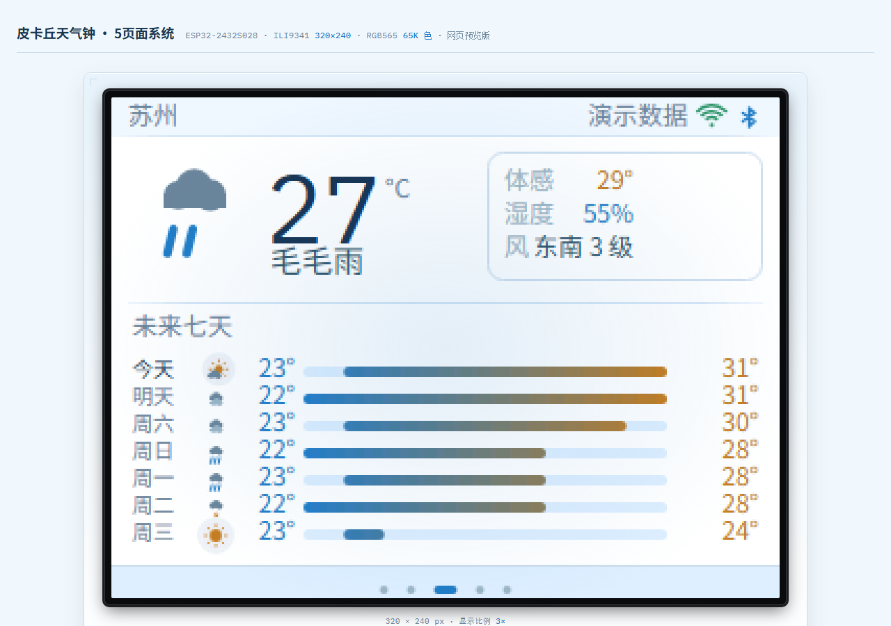
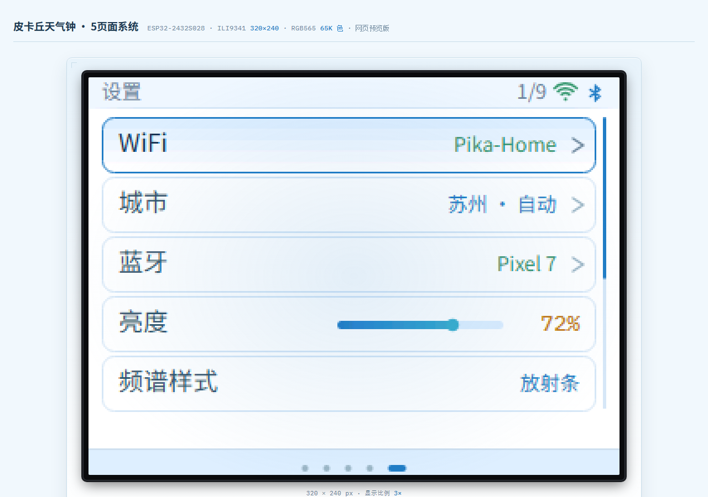

# 开发板1 · 皮卡丘天气钟(ESP32-2432S028)

ESP32-2432S028(ESP32 + ILI9341 2.8 寸 320×240 触摸屏)的 5 页面桌面摆件项目。
固件和 [网页预览](preview/ui.html)同步维护;固件由 `firmware/` 构建,可烧录镜像放在 `release/`。

## 页面(5 个)

| 页 | 内容 |
|---|---|
| **时钟** | 奔跑的皮卡丘**固定在屏幕正中原地跑**(像素精灵 4 帧步态,地面/草丛向左滚制造前进感,点它会跳) + 大时间 + 天气 chip(点击跳天气页)。背景是**天气场景**:天空颜色/太阳月亮/云/雨/雪/雾/闪电全部由「当前天气 × 一天时段」决定 |
| **音乐** | 蓝牙(NimBLE NUS)收手机端推的 `META\|歌名\|歌手`、`LRC\|歌词`、`SPEC\|16段频谱`。蓝色唱盘与蓝青音波在左,歌名歌手歌词在右;上一曲/播放/下一曲三键横排在下。上下滑切换 3 种音波样式 |
| **天气** | 近 7 天预报详情(图标/高低温/温度区间条)+ 当前概要(体感/湿度/风),两种视图 |
| **日期** | 月日历,阳历+农历双显示,节日红字、节气绿字、今日高亮,上下滑切月 |
| **设置** | WiFi 配网(扫描列表 → 虚拟键盘输密码 → 连接)、城市(自动 IP 定位 / 热门 / 省份 / 拼音搜索钉死)、亮度、频谱样式、蓝牙、恢复默认 |

操作:左右滑翻页(循环),上下滑页内操作,点按触发按钮。

## 风格统一(五页一台设备)

- **皮卡丘只在时钟页**,固定在屏幕正中原地跑;其余四页不放它,只共用同一套视觉语言
- 只有时钟页保留天气天空、皮卡丘、草地和泥土;其它四页使用淡蓝底 `#EDF6FD`、白色内容区和 16px 淡蓝导航区
- 选中态 `#D9ECFF`,主蓝 `#267EC7`,深蓝标题 `#1B3650`;皮卡丘精灵保留原有自身调色板
- 步频和地面滚动速度**挂钩**(地面走 22px = 一个 4 帧步态循环),脚不打滑
- 时钟页页点在草地上加深色描边；其余四页页点位于淡蓝导航区
- 全部图形都由代码画出,**没有外部图片依赖**,离线可用

## 天气场景覆盖(重点设计)

场景 = **天气组 × 时段**,参考 Meteoicons 的「WMO 代码 + 昼夜变体」思路:

- **12 种天气组**:晴 / 基本晴 / 少云 / 阴 / 雾 / 毛毛雨 / 雨 / 大雨(带风) / 冻雨(泛蓝+冰晶) / 雪(地面积雪) / 大雪 / 雷暴(随机闪电)
- open-meteo 的 **28 个有效 WMO weather_code** 都有映射
- **时段自动渐变**:按真实小时在 11 个天空关键帧(深夜→黎明→日出→正午→日落→黄昏→深夜)之间插值
- **白天/夜晚两套天体**:白天太阳沿弧线移动(早晚偏橙),夜晚月亮 + 闪烁星星,**月相按农历日期画**(朔→望→朔)
- 天气还影响地面:雪天积雪覆盖、雨天草色变深、风大云快雨斜

在网页预览右侧「**场景实验室**」可以逐个组合预览,不用等真实天气。

## 数据策略(联网/断网)

- **连上 WiFi 后自动认城市**:用公网 IP 调 `http://ip-api.com`(HTTP,不是 HTTPS——这块板剩余堆扛不住 TLS),对上国内地级市名录就用标准名;预报坐标采用接口返回值。没有 GPS,定位到市一级
- 设置页「城市」可以改:自动定位 / 20 个热门 / 29 个省份下钻 / 拼音全拼或首字母搜索(`sz` / `suzhou`)。手选会**钉死**,下次重连不会被 IP 覆盖;点「自动定位」才改回来
- 出厂默认苏州、自动模式;恢复默认会清掉 WiFi 和城市钉死,回到自动 + 苏州
- 联网时**一次拉 7 天预报**缓存住(open-meteo,HTTP,同参考固件——TLS 握手在剩余堆下会失败)
- 连网约 1.5 秒后刷新,成功后每 **30 分钟**刷新一次(预览压缩为 40 秒);失败按 30/60/120/300 秒退避。自动定位只有成功后才记为完成
- **断网继续用地点匹配的缓存**:页面标注离线和更新时间;地点变更后无匹配数据则显示空状态,旧城市数值不会被改名。时钟照走(板载 RTC)
- 未配网且无可信缓存时用演示数据,角标明确标识;点击角标直达设置页配网

## 网页预览

打开 `preview/ui.html`(Chrome/Edge)。

- 画布严格 320×240,像素放大 2×/3×/4×,所有颜色跑 RGB565 量化(和真机面板一致)
- 右侧控制台:页面切换 / 场景实验室 / 联网模拟(未配网/在线/断网 + 演示数据/在线 API + 自动定位/热门城市 + 手动刷新) / 蓝牙状态 / 保真开关(量化、像素栅格、热区可视化)
- 数据源可切**真实 API**:浏览器直连 api.open-meteo.com 拉 7 天预报;缺字段或拉取失败保留匹配的缓存,否则显示空状态
- 音乐页频谱为模拟数据;真机走 BLE

### 网页预览截图

以下截图来自 `preview/ui.html`,保留了网页控制台和 3 倍放大的 320×240 设备画布:

| 时钟 | 音乐 | 天气 |
|---|---|---|
|  |  |  |

| 日期 | 设置 |
|---|---|
|  |  |

## 与参考项目(E:\xiangmu\开发板)的关系

复用其成熟部分,差异部分新做:

- **复用**:页面状态机 + 翻页动画结构、XPT2046 触摸/手势阈值(45px/1.6 轴比/900ms)、热区系统、农历库(LUNAR_TAB 2020-2049 + 节气偏移表,已对过 59 个已知日期)、open-meteo 对接、BLE 协议、WiFi 配网 + 虚拟键盘
- **新做**:皮卡丘像素精灵(点阵数据可直接进固件)、天气场景引擎(天空/天体/粒子,对应固件里的场景绘制函数)、蓝白界面(已做 RGB565 对齐)、环形音波(替掉参考项目的竖条频谱)
- **去掉**:相册页(TF 卡),本项目 5 页

## 目录

```
开发板1/
├── README.md            本文件
├── release/             打包好的固件(直接刷,不用装工具链)
│   ├── flash.ps1          独立烧录脚本(自动找口,内置 esptool 调用)
│   ├── README.md          刷机说明 + 手动偏移 + 校验值
│   ├── final/             2026-09-08 旧正式版三个 bin
│   ├── 正式版刷机包-20260924/  本次正式版三个 bin 与独立刷机脚本
│   ├── 正式版刷机包-20260908/  旧正式版独立刷机包
│   └── backup-before-20260908/ 旧版构建前备份
├── firmware/            PlatformIO 工程(改代码用)
│   ├── platformio.ini     两个环境:cyd / cyd-demo
│   ├── src/
│   │   ├── main.cpp         初始化 + 主循环(触摸/WiFi/BLE/天气调度)
│   │   ├── pages.cpp        5 页面渲染 + 输入 + 弹窗 + 偏好(NVS)
│   │   ├── scene.cpp        天气场景引擎 + 时钟页地面
│   │   ├── pika.cpp         皮卡丘精灵点阵(与预览逐字符一致)
│   │   ├── gfx.cpp          绘图底座(Sprite/卡片/图标/大号数字)
│   │   ├── text.cpp         中文渲染(u8g2 点阵,12/16 两号)
│   │   ├── lunar.cpp        农历(2020-2049 + 节气偏移表)
│   │   ├── wx.cpp           open-meteo 对接 + IP 定位 + 缓存
│   │   ├── cities.cpp       国内地级市名录(拼音搜索 / 省份)
│   │   ├── touch.cpp        XPT2046 + 手势 + 热区
│   │   ├── keyboard.cpp     虚拟键盘(WiFi 密码 / 城市拼音)
│   │   └── wifi_config.cpp  配网(扫描/连接/持久化)
│   └── tools/
│       ├── flash.ps1        构建 + 烧录(自动找口)
│       ├── check_sprite.py  精灵点阵 vs 预览
│       └── check_theme.py   配色表 vs 预览
└── preview/
    ├── ui.html          网页预览(单文件,离线可用,字体有本机回退)
    ├── tools/
    │   ├── smoke.js       无头自检:打桩 canvas 跑全部页面/变体/热区/手势/50 秒长跑
    │   ├── shot.ps1       单页截图(Edge headless,自动裁出画面并放大)
    │   ├── shots.ps1      批量截图五页、天气变化和弹窗,生成 _shot/_sheet.png
    │   ├── pika-run.ps1   皮卡丘奔跑精灵设计自检(4 帧对照 + 2× 实尺寸)
    │   └── render-sprite.ps1  旧版趴姿精灵(已被 pika-run.ps1 取代,留档)
    ├── screenshots/       网页预览截图
    ├── _shot/             截图产物(自检用,可随时删)
    ├── _pika/             早期参考素材(官方 GIF/PNG;ui.html 已不依赖任何图片)
    └── references/        调研资料 + 参考界面截图
```

写 .ps1 脚本注意:Windows PowerShell 5.1 按 ANSI 读脚本文件,里面**不能写中文**(会乱码成语法错误);
另外别在截图脚本里设 `$ErrorActionPreference='Stop'`——Edge 往 stderr 写噪声会被当成错误,脚本会在 PNG 落盘前中止。

自检命令(改完 UI 先跑这两条):

```
node preview/tools/smoke.js
powershell -File preview/tools/shots.ps1
```

预览支持 URL 片段直接定位状态,方便截图审阅:
`ui.html#page=1&spec=2`、`ui.html#page=0&wx=snow&tod=night`
(参数 page / spec / v / play / bt / net / wx / tod / modal)

## 固件(可烧录)

**本次正式版在 `release/正式版刷机包-20260924/`，仓库根目录另有同名 ZIP。** 完整解压后运行：

```
powershell -File release\正式版刷机包-20260924\flash.ps1
```

`release/flash.ps1` 仍刷 `release/final/` 中的 2026-09-08 旧版。新包的镜像校验值、真机验收状态与参数见 [release/README.md](release/README.md)。

`firmware/` 是 PlatformIO 工程(改代码用),界面按 `preview/ui.html` 1:1 移植。

```
powershell -File firmware\tools\flash.ps1              # 构建 + 自动找口烧录
powershell -File firmware\tools\flash.ps1 -Port COM3   # 指定串口
powershell -File firmware\tools\flash.ps1 -Demo        # 烧演示版(假数据,不连网/蓝牙)
powershell -File firmware\tools\flash.ps1 -Monitor     # 烧完打开串口监视
```

脚本会自动排除蓝牙虚拟 COM 口;板子没插时只构建并提示,不会误刷。
两个环境:`cyd` 日常用,`cyd-demo` 是假频谱/假歌词/假天气的演示版。

**与预览的一致性用脚本校验**(手抄点阵和色值太容易错):

```
python firmware\tools\check_sprite.py   # 48 行精灵点阵逐字符比对
python firmware\tools\check_theme.py    # 主题色 + 7 精灵色逐值比对
```

已知的、刻意保留的差异只有一处:预览用了 10px 中文,固件只带 12/16 两号中文字库
(一套 wqy_t_gb2312 = 318KB Flash,加第三号不值),10px 处一律用 12px 顶上。
